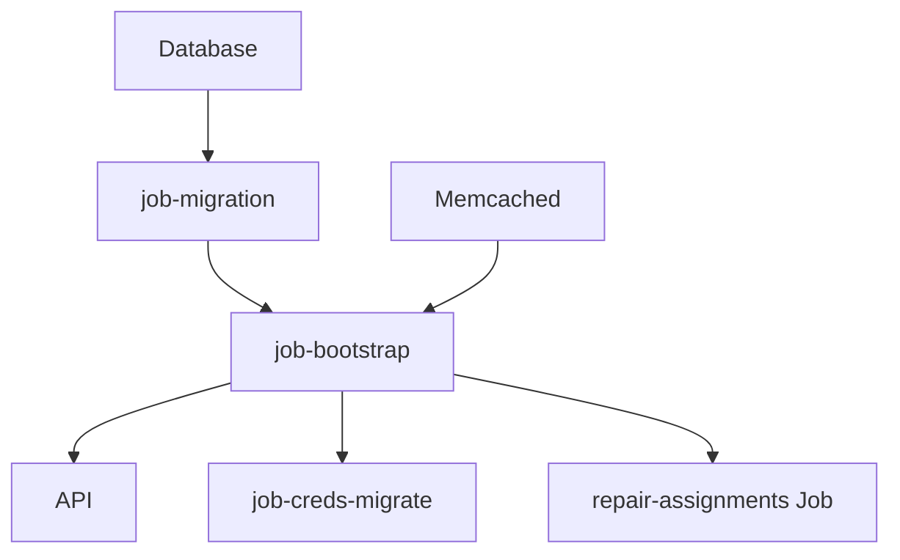
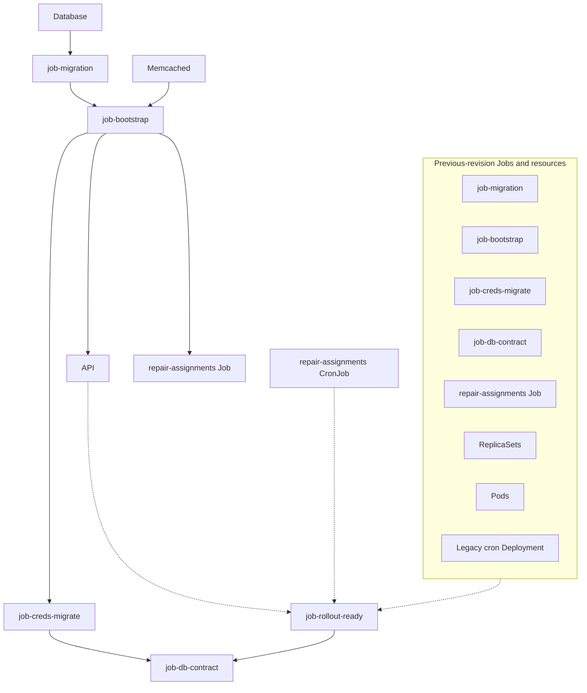

# Keystone

This chart deploys Keystone's API, a role-assignment repair CronJob, and their
database/cache dependencies. Startup and upgrade ordering is implemented by
ordinary Kubernetes Jobs and `kubernetes-entrypoint` dependency checks.

## Jobs

- **`job-migration`** prepares the database before bootstrap: full `db_sync` for
  a new database, or `db_sync --expand` on upgrade.
- **`job-bootstrap`** runs native and extension bootstrap after database
  preparation, before new API containers start, on both installs and upgrades.
- **`job-creds-migrate`** re-encrypts credentials after bootstrap. It can run
  alongside API startup and rollout.
- **`job-rollout-ready`** runs only on upgrades, after migration and bootstrap.
  It checks the target API revision is ready and the repair CronJob template is
  updated. Older migration, bootstrap, credential, contract and repair Jobs
  must no longer be able to run; old ReplicaSets must have no replicas, old
  pods must have terminated, and the legacy cron Deployment must be removed.
  Current credential and repair Jobs do not have to finish for this check.
- **`job-db-contract`** runs on every upgrade that expands the database, after
  bootstrap, credential migration and rollout verification. It rechecks rollout, runs
  `db_sync --contract`, and verifies the final schema.
- **`repair-assignments`** is scheduled by its CronJob. Each Job waits for
  bootstrap before repairing role assignments. Scheduled runs do not overlap.

## Dependencies

Solid arrows show successful Job or available Service prerequisites. Dashed
arrows show resource-state checks, not Job execution dependencies: API readiness,
the target CronJob template, and retirement of older workloads. Contraction
repeats those checks immediately before modifying the schema.

Transitive dependencies are omitted to keep the graphs readable. They assume
migration is enabled. Job names also include the release name and Helm revision.

After bootstrap, API pods run the schema check and then
`keystone-status upgrade check` before starting the API container. Bootstrap
and repair Jobs run only the schema check. The API never waits for contraction.

### Installation

### Upgrade

