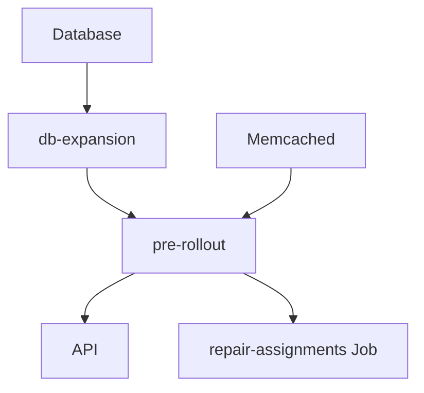
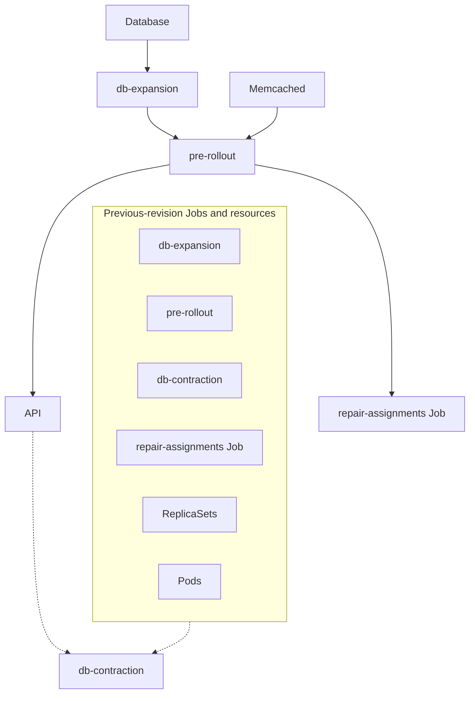

# Keystone

This chart deploys Keystone's API, a role-assignment repair CronJob, and their
database/cache dependencies. Startup and upgrade ordering is implemented by
ordinary Kubernetes Jobs and `kubernetes-entrypoint` dependency checks.

## Jobs

- **`db-expansion`** runs when `run_db_migration` is true: full `db_sync` on
  installation, or `db_sync --expand` on upgrade.
- **`pre-rollout`** waits for database preparation, when enabled, then runs
  schema validation, native/extension bootstrap, credential migration,
  `keystone-manage doctor`, and `keystone-status upgrade check`, in that order,
  in a single Bash script.
  Bootstrap, schema, credential and upgrade-check errors fail the Job.
  Upgrade-check warnings are accepted. API and repair pods wait for this Job, so these steps
  run once per release revision rather than in every API pod.
- **`db-contraction`** runs after expansion on upgrades. It waits for
  `pre-rollout`, checks the target API revision is ready, then runs
  `db_sync --contract` and verifies the final schema. Earlier revisions of
  these Jobs must no longer be able to run,
  old API ReplicaSets must have no replicas, and old pods must have terminated.
- **`repair-assignments`** is scheduled by its CronJob. Each run waits for
  `pre-rollout` before repairing role assignments.

## Dependencies

Solid arrows show Job/Service prerequisites; dashed arrows show resource-state
checks. Transitive dependencies are omitted. Job names include the release name
and Helm revision. The API never waits for contraction.

Complete an upgrade before starting the next: previous-revision Jobs and
script ConfigMaps are not retained when Helm replaces them.

The graphs assume `run_db_migration: true`. When false, both database migration
Jobs are omitted and the schema must already be prepared. Installation uses a
full synchronization and does not need a separate contraction Job.

### Installation

### Upgrade

