# Metal Settings Helm Chart

This Helm chart deploys BIOS/BMC firmware versions and settings for bare-metal servers managed by metal-operator / metal-maintenance-operator.

## Overview

Every vendor/model is configured through two separate, single-purpose places in `values.yaml`:

1. **`parameters:`** — USER INPUT. Per vendor/model firmware/settings data (version, imagePath/imageURI, settingsFileName/settingsContent), `enabled` toggles, and an optional `rollouts:` override (see below). The only place that changes when bumping a firmware version, a settings file, or turning a vendor/model/domain/variant on or off.
2. **`Workflow:` / `rollouts.types:`** — WORKFLOW. `Workflow:` is the static, vendor/model-agnostic definition of the 6-step chain shape (stepName/kind, in order). `rollouts.types:` maps every known cluster type to a LIST OF RULES (each optionally filtered by model/server) that select which `Workflow` applies — see [rollouts.types](#rolloutstypes--workflowserver-selection-keyed-by-cluster-type) below.

`_helpers.tpl`'s `metal-settings.computedChain` combines both (plus the `crdVersionControl.features.readinessGates.enabled` feature flag) into the final ordered chain for a given model + cluster type, which the 5 step templates render into Kubernetes custom resources:

| Kind | Rendered | Purpose |
|------|----------|---------|
| `BMCSettingsSet`  | once per effective cluster type | BMC manager settings (disabled by default) |
| `BMCVersionSet`   | once per model | Target BMC firmware version |
| `BIOSVersionSet`  | once per model | Target BIOS firmware version |
| `BIOSSettingsSet` | once per effective cluster type | BIOS configuration settings |
| `FirmwareUpdateSet` | once per effective cluster type | Dell repository-based firmware update (disabled by default) |

Additionally, when `bmcSettings.enabled` is true and the corresponding name is set, the chart creates:
- A `ConfigMap` (`clusterConfig.configMapName`) holding cluster-level values (e.g. syslog server).
- A `Secret` (`clusterConfig.hpeLicenseSecretName`) holding the HPE iLO license key.

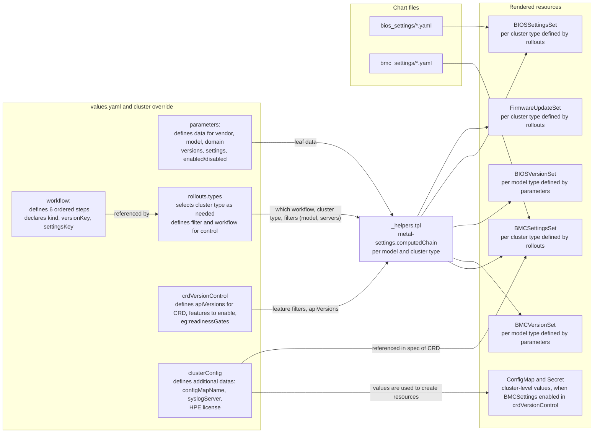

Settings content is stored as flat YAML files under `bios_settings/` and `bmc_settings/`, referenced by filename via `settingsFileName` (or inlined via `settingsContent`). See [Parameters](#parameters-parameters--user-input), [Workflow](#workflow--the-static-workflow-shape), and [rollouts.types](#rolloutstypes--workflowserver-selection-keyed-by-cluster-type) below for the full schema, [crdVersionControl](#crdversioncontrol) for per-kind toggles and ordered/gated rollouts, and [setMetadataName](#setmetadataname-custom--dynamic-resource-names) for custom/dynamic resource naming.

## How the Resources Are Generated

Two stages run for every model and cluster type: each step template drives the render and calls `computedChain`, which decides which steps the model gets and how they are wired together.

### 1. Rendering each step (step templates)

All five step templates (`bios_settings`, `bios_versions`, `bmc_settings`, `bmc_versions`, `firmware_updates`) follow this path; each renders only its own kind:

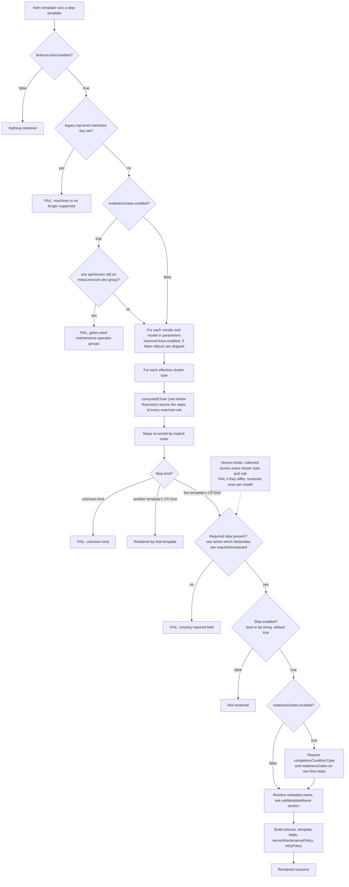

### 2. Resolving the chain (`computedChain`)

What `computedChain` does for one model at one cluster type, before the template renders anything:

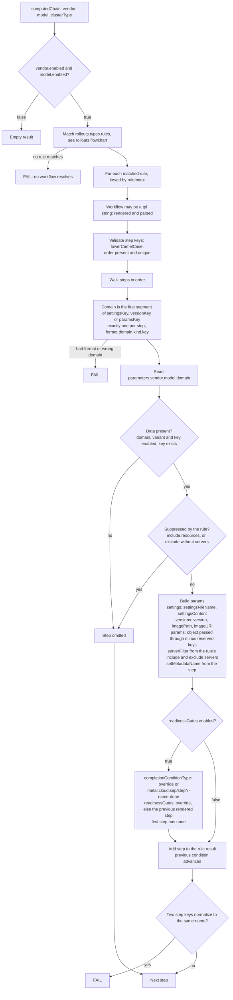

An omitted step does not advance the previous condition, so the next rendered step gates on the nearest earlier step that was rendered.

## From `values.yaml` to Rendered Resource

One real, complete worked example — Dell PowerEdge R7615, `cc-kvm-compute` cluster type, default (non-gated) rendering — showing exactly where every field in each kind of rendered Custom Resource comes from.

Every input and the field it ends up in on a rendered resource:

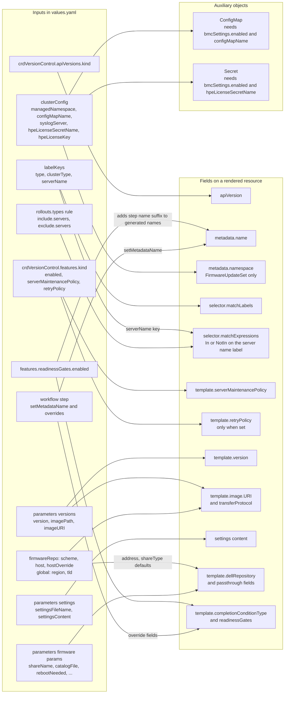

How each CR's spec data is resolved. Every step reads its data from `parameters.<vendor>.<model>.<domain>`, at the path given by the step's `settingsKey`, `versionKey` or `paramsKey`:

```mermaid
flowchart TD
    subgraph SETK["BIOSSettingsSet and BMCSettingsSet"]
        S0["parameters.vendor.model.#lt;bios or bmc#gt;.settings.#lt;key#gt;"]
        S0 --> S1{"Entry is a plain string or an object?"}
        S1 -->|"string"| S2["settingsFileName = the string"]
        S1 -->|"object"| S3["settingsFileName and or settingsContent<br/>plus optional enabled"]
        S2 --> S4{"settingsContent set?"}
        S3 --> S4
        S4 -->|"yes"| S5["Inline content used as is<br/>wins over settingsFileName"]
        S4 -->|"no"| S6{"Kind?"}
        S6 -->|"BIOS"| S7["bios_settings file inlined verbatim"]
        S6 -->|"BMC"| S8["bmc_settings file rendered with tpl<br/>so clusterConfig values can be used"]
        S0 -->|"if the workflow step has a versionKey"| SV2["reads and sets the version field of that versions entry"]
        S0 -->|"neither file nor content"| SX["FAIL"]
    end

    subgraph VERK["BIOSVersionSet and BMCVersionSet"]
        V0["parameters.vendor.model.#lt;bios or bmc#gt;.versions.#lt;key#gt;<br/>fields: version, imagePath, imageURI"]
        V0 --> VV["template.version = version<br/>FAIL when missing"]
        V0 --> V1{"imageURI set?"}
        V1 -->|"yes"| V2["image.URI = imageURI"]
        V1 -->|"no"| V3{"firmwareRepo.hostOverride set?"}
        V3 -->|"yes"| V4["host = hostOverride"]
        V3 -->|"no"| V5["host = host.region.tld"]
        V4 --> V6["image.URI = scheme://host + imagePath<br/>FAIL when imagePath is missing too"]
        V5 --> V6
        V2 --> V7["transferProtocol = upper-cased firmwareRepo.scheme"]
        V6 --> V7
    end

    subgraph FWK["FirmwareUpdateSet"]
        F0["parameters.vendor.model.firmware.params.#lt;key#gt;"]
        F0 --> F1["Whole object taken as is<br/>except enabled and the override keys"]
        F1 --> F2["Dell repository fields packed into dellRepository<br/>shareName, catalogFile, shareType, address, rebootNeeded, ...<br/>flat, or already nested under dellRepository"]
        F1 --> F5["Every other field passed through to the CR spec<br/>e.g. progressDeadlineSeconds"]
        F2 --> F6{"Any Dell repository field?"}
        F6 -->|"no"| FX["FAIL"]
        F6 -->|"yes"| F7{"address and shareType set per model?"}
        F7 -->|"no"| F8["address from firmwareRepo host<br/>shareType = upper-cased scheme"]
        F7 -->|"yes"| F9["Per-model values kept"]
        F10["serverMaintenancePolicy and retryPolicy<br/>always from crdVersionControl.features.firmware"]
    end
```

`Workflow:` + `rollouts.types:` decide the SHAPE of each step (`order`/`kind`/`versionKey`/`settingsKey`) and which cluster type(s) get a resource at all - `parameters:` only ever supplies the leaf data a step's `versionKey`/`settingsKey`/`paramsKey` points at. `poweredge-r7615` doesn't override either, so it resolves to the chart's single default rule for every cluster type (see [Workflow](#workflow--the-static-workflow-shape) / [rollouts.types](#rolloutstypes--workflowserver-selection-keyed-by-cluster-type) above):

```yaml
defaultRollouts:
  types:
    cc-kvm-compute:
      - workflow: *workflow   # one rule, no filter -> matches every model, including poweredge-r7615

workflow: &workflow
  bmcSettingsInitial:
    order: 1
    kind: BMCSettingsSet
    settingsKey: bmc.settings.initialSettings
    enabled: "{{ .Values.crdVersionControl.features.readinessGates.enabled }}"
    # crdVersionControl.features.readinessGates.enabled defaults to false -> this step's "enabled"
    # resolves to false -> no BMCSettingsSet is rendered for bmc-settings-initial at all (see
    # metal-settings.stepEnabled in _helpers.tpl). Set that flag true to turn this step on instead.
  bmcVersion:
    order: 2
    kind: BMCVersionSet
    versionKey: bmc.versions.defaultVersion   # -> reads parameters.dell.poweredge-r7615.bmc.versions.defaultVersion
  biosVersion:
    order: 3
    kind: BIOSVersionSet
    versionKey: bios.versions.defaultVersion   # -> reads parameters.dell.poweredge-r7615.bios.versions.defaultVersion
  biosSettings:
    order: 5
    kind: BIOSSettingsSet
    versionKey: bios.versions.defaultVersion
    settingsKey: bios.settings.defaultSettings  # -> reads parameters.dell.poweredge-r7615.bios.settings.defaultSettings
    # Optional per-step overrides (none set here, so every rendered resource below uses the
    # auto-computed defaults): setMetadataName (custom name), completionConditionTypeOverride /
    # readinessGatesOverride (only meaningful once crdVersionControl.features.readinessGates.enabled
    # is true - see "Readiness-Gate Chaining" below).
  firmware:
    order: 6
    kind: FirmwareUpdateSet
    paramsKey: firmware.params.defaultVersion   # -> reads parameters.dell.poweredge-r7615.firmware.params.defaultVersion, verbatim
```

Input (`values.yaml`, trimmed to what this example needs):

```yaml
labelKeys:
  type: "kubernetes.metal.cloud.sap/type"
  clusterType: "kubernetes.metal.cloud.sap/cluster-type"
firmwareRepo:
  scheme: https
  host: repo
global:
  region: eu-de-1
  tld: cloud.sap
crdVersionControl:
  apiVersions:
    biosSettingsSet: metal.ironcore.dev/v1alpha1
    bmcSettingsSet: metal.ironcore.dev/v1alpha1
    biosVersionSet: metal.ironcore.dev/v1alpha1
    bmcVersionSet: metal.ironcore.dev/v1alpha1
    firmwareUpdateSet: system.metal.ironcore.dev/v1alpha1

parameters:
  dell:
    poweredge-r7615:
      bmc:
        versions:
          defaultVersion:
            version: "7.20.60.50"
            imagePath: "/hw-firmware/dell/poweredge-r7615/iDRAC-with-Lifecycle-Controller_Firmware_6CKFT_WN64_7.20.60.50_A00.EXE"
        settings:
          defaultSettings: dell-default.yaml
      bios:
        versions:
          defaultVersion:
            version: "1.11.2"
            imagePath: "/hw-firmware/dell/poweredge-r7615/BIOS_5MVJG_WN64_1.11.2.EXE"
        settings:
          defaultSettings: dell-r7615.yaml
      firmware:
        params:
          defaultVersion:
            shareName: "/hw-firmware/dell/dell_vpod_fw_repository/firmware_80u3_04_2026"
            catalogFile: "Driver_and_Firmware_20_04_2026_Converged_Cloud_wo_BIOS_idrac_Catalog.xml"
            certificateVerification: Ignore
            rebootNeeded: true
            progressDeadlineSeconds: 3600
```

### → `BIOSSettingsSet`

```yaml
apiVersion: metal.ironcore.dev/v1alpha1        # crdVersionControl.apiVersions.biosSettingsSet
kind: BIOSSettingsSet
metadata:
  name: dell-poweredge-r7615-cc-kvm-compute    # auto-computed: "<vendor>-<model>-<clusterType>" (lower-cased)
                                                # - no setMetadataName set on the bios-settings Workflow step, so this is the default
spec:
  serverSelector:
    matchLabels:
      kubernetes.metal.cloud.sap/type: poweredge-r7615          # labelKeys.type: <model> (the parameters.dell.<model> map key)
      kubernetes.metal.cloud.sap/cluster-type: cc-kvm-compute   # labelKeys.clusterType: <clusterType> currently being rendered
    # No matchExpressions block: no matching rollouts.types rule set an include.servers/
    # exclude.servers -> targets every server matching the labels above. If the matched rule DID
    # set e.g. filter.include.servers: [node003-bb086], this would instead render:
    #   matchExpressions:
    #     - key: kubernetes.metal.cloud.sap/name
    #       operator: In
    #       values: ["node003-bb086"]
    # (operator: NotIn when the servers came from "exclude" instead of "include" - see
    # metal-settings.serverMatchExpressions in _helpers.tpl).
  biosSettingsTemplate:
    serverMaintenancePolicy: OwnerApproval       # crdVersionControl.features.biosSettings.serverMaintenancePolicy
    retryPolicy:
      maxAttempts: 5                             # crdVersionControl.features.biosSettings.retryPolicy
    settingsFlow:                                 # content of bios_settings/dell-r7615.yaml (parameters.dell.poweredge-r7615.bios.settings.defaultSettings),
    - name: enableIntegratedNIC                   # loaded via $.Files.Get and inlined verbatim (not rendered via tpl, unlike BMC settings below)
      priority: 10
      settings:
        EmbNic1Nic2: Enabled
    # ...rest of bios_settings/dell-r7615.yaml's settingsFlow entries...
    version: "1.11.2"                             # parameters.dell.poweredge-r7615.bios.versions.defaultVersion.version
```

### → `BIOSVersionSet` (rendered once per model, not per cluster type)

```yaml
apiVersion: metal.ironcore.dev/v1alpha1        # crdVersionControl.apiVersions.biosVersionSet
kind: BIOSVersionSet
metadata:
  name: dell-poweredge-r7615                    # auto-computed: "<vendor>-<model>" - no clusterType suffix (Version-kind steps render once per model)
                                                 # - a setMetadataName on the bios-version step would replace this outright, used verbatim (no suffix)
spec:
  serverSelector:
    matchLabels:
      kubernetes.metal.cloud.sap/type: poweredge-r7615   # labelKeys.type: <model> - no clusterType label (applies regardless of cluster type)
  biosVersionTemplate:
    serverMaintenancePolicy: OwnerApproval       # crdVersionControl.features.biosVersions.serverMaintenancePolicy
    version: "1.11.2"                            # parameters.dell.poweredge-r7615.bios.versions.defaultVersion.version
    image:
      # firmwareRepo.scheme + "://" + firmwareRepo.host + "." + global.region + "." + global.tld + imagePath
      # Overrides available: firmwareRepo.hostOverride replaces "firmwareRepo.host + region + tld" outright for
      # every model; versions.defaultVersion.imageURI (legacy) replaces this whole composed URI for just this
      # one version variant instead of imagePath (see "Firmware Repository" below).
      URI: "https://repo.eu-de-1.cloud.sap/hw-firmware/dell/poweredge-r7615/BIOS_5MVJG_WN64_1.11.2.EXE"
      transferProtocol: "HTTPS"                  # upper(firmwareRepo.scheme) - follows the same host/scheme config as the URI above.
    retryPolicy:
      maxAttempts: 5                             # crdVersionControl.features.biosVersions.retryPolicy
```

### → `BMCVersionSet` (rendered once per model, mirrors `BIOSVersionSet`)

```yaml
apiVersion: metal.ironcore.dev/v1alpha1        # crdVersionControl.apiVersions.bmcVersionSet
kind: BMCVersionSet
metadata:
  name: dell-poweredge-r7615
spec:
  bmcSelector:
    matchLabels:
      kubernetes.metal.cloud.sap/type: poweredge-r7615
  bmcVersionTemplate:
    serverMaintenancePolicy: OwnerApproval       # crdVersionControl.features.bmcVersions.serverMaintenancePolicy
    version: "7.20.60.50"                       # parameters.dell.poweredge-r7615.bmc.versions.defaultVersion.version
    image:
      # Same composition + override rules as BIOSVersionSet above (firmwareRepo.hostOverride / versions.<key>.imageURI)
      URI: "https://repo.eu-de-1.cloud.sap/hw-firmware/dell/poweredge-r7615/iDRAC-with-Lifecycle-Controller_Firmware_6CKFT_WN64_7.20.60.50_A00.EXE"
      transferProtocol: "HTTPS"                  # upper(firmwareRepo.scheme), same as BIOSVersionSet above
    retryPolicy:
      maxAttempts: 5                             # crdVersionControl.features.bmcVersions.retryPolicy
```

### → `BMCSettingsSet` (disabled by default — requires `clusterConfig` + `crdVersionControl.features.bmcSettings.enabled: true`)

```yaml
crdVersionControl:
  features:
    bmcSettings:
      enabled: false   # the chart's actual default - with this (unchanged), bmc_settings.yaml's top-level
                       # {{- if .Values.crdVersionControl.features.bmcSettings.enabled }} is false, so NO
                       # BMCSettingsSet is rendered for ANY model/cluster type - not even an empty list, the
                       # whole template produces no output. Set true (and clusterConfig.configMapName/
                       # syslogServer) to render the resource shown below.
```

```yaml
apiVersion: metal.ironcore.dev/v1alpha1
kind: BMCSettingsSet
metadata:
  name: dell-poweredge-r7615-cc-kvm-compute
spec:
  bmcSelector:
    matchLabels:
      kubernetes.metal.cloud.sap/type: poweredge-r7615
      kubernetes.metal.cloud.sap/cluster-type: cc-kvm-compute
    # Same serverFilter -> matchExpressions behavior as BIOSSettingsSet above.
  bmcSettingsTemplate:
    serverMaintenancePolicy: OwnerApproval       # crdVersionControl.features.bmcSettings.serverMaintenancePolicy
    version: "7.20.60.50"                       # parameters.dell.poweredge-r7615.bmc.versions.defaultVersion.version
    # Content of bmc_settings/dell-default.yaml (parameters.dell.poweredge-r7615.bmc.settings.defaultSettings), loaded via
    # $.Files.Get and rendered via `tpl` (unlike BIOS settings) - so it can reference clusterConfig.* Helm values directly:
    settings:
      IPMILan.1.Enable: "Enabled"
      SysLog.1.Server1: "$(SyslogServer)"         # literal $(...) left for the operator to resolve at reconcile time (see "variables" below) - not Helm templating
      # ...rest of bmc_settings/dell-default.yaml's settings...
    variables:
      # Every "variables" entry below is static template content from bmc_settings/dell-default.yaml - resolved by the
      # operator at reconcile time (objectFieldRef/configMapKeyRef), not by this chart.
      - key: SyslogServer
        valueFrom:
          configMapKeyRef:
            name: metal-bmc-settings              # clusterConfig.configMapName
            namespace: metal-servers              # clusterConfig.managedNamespace
            key: syslogServer                     # ConfigMap's own data.syslogServer == clusterConfig.syslogServer (see bmc-settings-configmap.yaml)
      # ...NodeName/BB/Region variables (objectFieldRef against BMC labels) - see bmc_settings/dell-default.yaml...
```

### → `FirmwareUpdateSet` (disabled by default — requires `crdVersionControl.features.firmware.enabled: true`)

```yaml
apiVersion: system.metal.ironcore.dev/v1alpha1  # crdVersionControl.apiVersions.firmwareUpdateSet
kind: FirmwareUpdateSet
metadata:
  name: dell-poweredge-r7615-cc-kvm-compute
  namespace: metal-servers                       # clusterConfig.managedNamespace
spec:
  serverSelector:
    matchLabels:
      kubernetes.metal.cloud.sap/type: poweredge-r7615
      kubernetes.metal.cloud.sap/cluster-type: cc-kvm-compute
    # Same serverFilter -> matchExpressions behavior as BIOSSettingsSet above.
  firmwareUpdateTemplate:
    dellRepository:
      # address/shareType default from firmwareRepo (host+region+tld / upper(scheme)), same composition as
      # BIOSVersionSet/BMCVersionSet's image.URI above - OR set firmware.params.<key>.address/.shareType
      # directly to override these two fields for just this one model's firmware step, independent of imagePath's
      # imageURI-style override (see the "generic escape hatch" note on firmware.params.<key> in values.yaml).
      address: repo.eu-de-1.cloud.sap             # firmwareRepo.host + "." + global.region + "." + global.tld (default, since not set per-model)
      shareType: HTTPS                            # upper(firmwareRepo.scheme) (default, since not set per-model)
      shareName: /hw-firmware/dell/dell_vpod_fw_repository/firmware_80u3_04_2026   # parameters.dell.poweredge-r7615.firmware.params.defaultVersion.shareName
      catalogFile: Driver_and_Firmware_20_04_2026_Converged_Cloud_wo_BIOS_idrac_Catalog.xml  # ...params.defaultVersion.catalogFile
      certificateVerification: Ignore             # ...params.defaultVersion.certificateVerification
      rebootNeeded: true                          # ...params.defaultVersion.rebootNeeded
    progressDeadlineSeconds: 3600                  # ...params.defaultVersion.progressDeadlineSeconds (passed through verbatim - see firmware.params.<key>'s "generic escape hatch" in values.yaml)
    retryPolicy:
      maxAttempts: 5                               # crdVersionControl.features.firmware.retryPolicy
    serverMaintenancePolicy: OwnerApproval         # crdVersionControl.features.firmware.serverMaintenancePolicy
```

## Cluster-Type Scoping and enabled Toggles

- **`rollouts.types:`** (top-level, optional) — the REAL cluster type(s) present on the cluster this release is deployed to, set via the cluster's own kube-secrets/foundation-deployment values override. — this lets user restrict deployment to a SUBSET of the chart's known cluster types. If left unset (the default), it falls back to `defaultRollouts.types` (the full catalog). See [rollouts.types](#rolloutstypes--workflowserver-selection-keyed-by-cluster-type) below for the full rule-list schema.
- **`enabled` toggles** cascade top-down through five independent, optional levels (all default `true` when unset — a disabled level skips every step under it regardless of its children's own `enabled` values): 
  - `parameters.<vendor>.enabled` (vendor), 
  - `parameters.<vendor>.<model>.enabled` (model), 
  - `parameters.<vendor>.<model>.<bmc|bios>.enabled` (domain), 
  - `parameters.<vendor>.<model>.<bmc|bios>.versions.<key>.enabled`, and `...settings.<key>.enabled` (one specific firmware/settings variant). 

See [Parameters](#parameters-parameters--user-input) below for a worked example at every level.

This enables testing a vendor/model in one region before a global rollout, gradual rollouts, disabling a not-yet-ready settings variant.

## Values

### Cluster Configuration (`clusterConfig`)

Cluster-level values shared across templates. These are region/deployment-specific and must be overridden per environment:

```yaml
clusterConfig:
  configMapName: ""             # Name of the ConfigMap created by this chart.
                                # Referenced by Dell BMCSettings variables (syslogServer).
                                # Required when bmcSettings.enabled=true and Dell models are used.
  syslogServer: ""              # Dell iDRAC syslog endpoint, e.g. "remotesyslog.cc.qa-de-1.cloud.sap"
  hpeLicenseSecretName: ""      # Name of the Secret created by this chart for the HPE iLO license.
                                # Required when bmcSettings.enabled=true and HPE models are used.
  hpeLicenseKey: ""             # HPE iLO license key value stored in the Secret above.
                                # In production, inject via Vault / SealedSecrets instead of plain values.
  managedNamespace: "metal-servers"   # Namespace where the ConfigMap/Secret above are deployed
```

## crdVersionControl

One top-level values key controlling both per-kind enable/retryPolicy toggles and optional ordered/gated rollout chaining.

### Per-kind enable toggles

```yaml
crdVersionControl:
  features:
    biosSettings:
      enabled: true                    # Enable/disable all BIOSSettingsSet resources
      serverMaintenancePolicy: OwnerApproval   # -> biosSettingsTemplate.serverMaintenancePolicy
      retryPolicy:
        maxAttempts: 5

    bmcSettings:
      enabled: false                   # Disabled by default - see below
      serverMaintenancePolicy: OwnerApproval   # -> bmcSettingsTemplate.serverMaintenancePolicy

    biosVersions:
      enabled: true
      serverMaintenancePolicy: OwnerApproval   # -> biosVersionTemplate.serverMaintenancePolicy
      retryPolicy:
        maxAttempts: 5

    bmcVersions:
      enabled: true
      serverMaintenancePolicy: OwnerApproval   # -> bmcVersionTemplate.serverMaintenancePolicy
      retryPolicy:
        maxAttempts: 5

    firmware:
      enabled: false                   # Disabled by default - Dell repository-based updates only
      serverMaintenancePolicy: OwnerApproval   # -> firmwareUpdateTemplate.serverMaintenancePolicy (always wins, same as every other kind)
      retryPolicy:
        maxAttempts: 5
```

`serverMaintenancePolicy` (`OwnerApproval` by default, for every kind) is passed straight through to each kind's own `<kind>Template.serverMaintenancePolicy` field - override per-kind to change who/what must approve maintenance on affected Servers.

All vendor/model entries are defined under `parameters:` in `values.yaml` (see below) — there's no separate filter configuration anymore; use `rollouts.types` and `enabled` toggles instead.

### BMCSettingsSet specifics

BMC settings are **disabled by default** and require `clusterConfig` values to be set for each region.

When enabled, one `BMCSettingsSet` is generated per `bmc-settings` chain step (once per effective cluster type). Settings content is loaded from `bmc_settings/<settingsFileName>` and rendered via `tpl`, allowing `{{ .Values.clusterConfig.* }}` references inside the files.

Dynamic per-BMC values (hostname, region, building-block) are resolved at reconcile time via `objectFieldRef` — they are **not** Helm values and require no chart configuration.

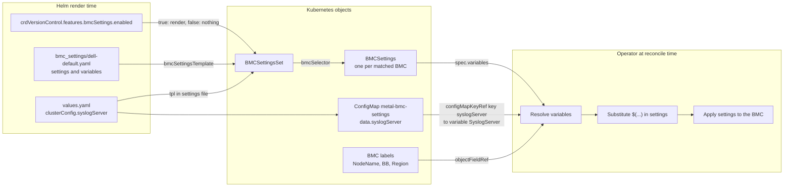

#### Enabling BMCSettings for Dell

```yaml
crdVersionControl:
  features:
    bmcSettings:
      enabled: true

clusterConfig:
  configMapName: metal-bmc-settings
  syslogServer: "remotesyslog.cc.qa-de-1.cloud.sap"
```

#### Enabling BMCSettings for HPE (with license key)

```yaml
crdVersionControl:
  features:
    bmcSettings:
      enabled: true

clusterConfig:
  hpeLicenseSecretName: hpe-ilo-license
  hpeLicenseKey: "XXXXX-XXXXX-XXXXX-XXXXX-XXXXX"  # or inject via Vault
```

### Readiness-Gate Chaining (apiVersions / readinessGates)

```yaml
crdVersionControl:
  apiVersions:
    biosSettingsSet: "metal.ironcore.dev/v1alpha1"
    bmcSettingsSet: "metal.ironcore.dev/v1alpha1"
    biosVersionSet: "metal.ironcore.dev/v1alpha1"
    bmcVersionSet: "metal.ironcore.dev/v1alpha1"
    firmwareUpdateSet: "system.metal.ironcore.dev/v1alpha1"
  features:
    readinessGates:
      enabled: false
```

- `apiVersions.*`: which CRD group/version to render the generated resources against. metal-operator (single-group) serves the four BIOS/BMC settings/version kinds under `metal.ironcore.dev/v1alpha1`. metal-maintenance-operator (multigroup) serves them under group-qualified versions: `system.metal.ironcore.dev/v1alpha1` for BIOS kinds, `baseboard.metal.ironcore.dev/v1alpha1` for BMC kinds. `FirmwareUpdateSet` is only served by metal-maintenance-operator's `system.metal.ironcore.dev/v1alpha1` group - there is no plain metal-operator equivalent.
- `features.readinessGates.enabled` (default `false`) changes **how** a model's chain steps are rendered, not where their data comes from:
  - `false` (default): each chain step renders as an independent resource with no `readinessGates`/`completionConditionType` fields — compatible with the plain metal-operator apiVersions.
  - `true`: each model's chain steps render as an ORDERED sequence of resources. A step only starts once the previous step's `completionConditionType` has been patched (`status: True`) onto the related Server(s) — mirroring metal-maintenance-operator's e2e chain test. Every rendered step must then set `completionConditionType`, and every non-first step must set `readinessGates` (the chart computes both generically; it fails fast if either is missing).

**Precondition**: enabling `readinessGates` requires `crdVersionControl.apiVersions.*` to already point at metal-maintenance-operator's groups — the plain metal-operator group has no `readinessGates`/`completionConditionType` fields at all. The chart fails fast if this precondition isn't met.

What changes between disabled and enabled:

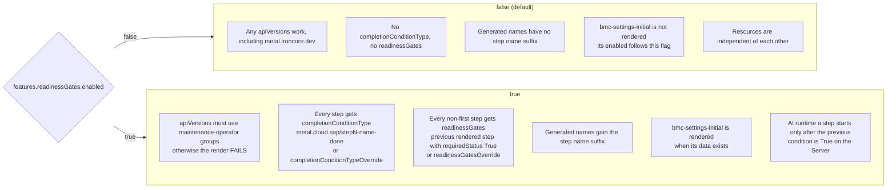

Naming convention used throughout the chart: `metal.cloud.sap/step<order>-<stepName>-done`, e.g. `metal.cloud.sap/step1-bmc-settings-initial-done`. `readinessGatesOverride` (set on a `Workflow` step definition — see [Workflow](#workflow--the-static-workflow-shape) below) replaces the auto-computed `readinessGates` outright — only needed for a step that must gate on something other than "the nearest preceding step this model has data for" (e.g. a one-off entry gating on a different model's step).

Chain order and gating when `features.readinessGates.enabled: true` (each completion condition is `metal.cloud.sap/<label>`):

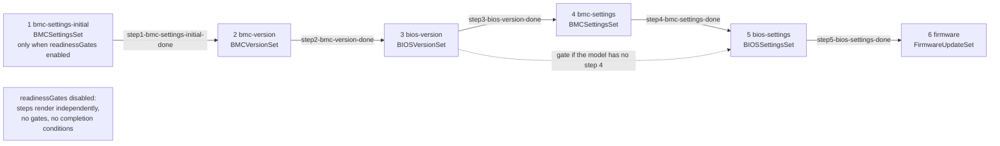

A step starts only after the previous step's condition is patched as `status: True` on the Server. A step the model has no data for is skipped and the gate falls back to the nearest earlier step that is rendered.

### Parameters (`parameters`) — user input

Per vendor/model firmware/settings data, keyed by the hardware model name (e.g. `poweredge-r640`):

```yaml
parameters:
  <vendor>:                          # dell | hpe | lenovo
    enabled: bool?                   # optional, default true - skips this whole vendor
    <model>:
      enabled: bool?                 # optional, default true - skips this whole model
      bmc:                           # (or bios:)
        enabled: bool?               # optional, default true - skips this whole domain
        versions:
          <versionKey>:              # e.g. defaultVersion
            version: "..."
            imagePath: "..."         # or imageURI - see Firmware Repository below
            enabled: bool?           # optional, default true - skips just this version variant
        settings:
          <settingsKey>: <fileName>  # shorthand: plain string, enabled=true
          <settingsKey>:             # or an object, when the variant needs its own enabled flag
            settingsFileName: <fileName>  # or settingsContent: <inline YAML>
            enabled: bool?
```

`parameters:` has no `rollouts` key at all (vendor or model level) - every workflow/server routing decision lives in `rollouts.types` instead, keyed off a model's name in a rule's `include`/`exclude` (see [rollouts.types](#rolloutstypes--workflowserver-selection-keyed-by-cluster-type) below).

 `setMetadataName`/`completionConditionTypeOverride`/`readinessGatesOverride` are entirely rendering/selection control, so they are controlled exclusively on the `Workflow` step definition itself — see [Workflow](#workflow--the-static-workflow-shape) below. `serverFilter` is also pure rendering/selection control, but lives on `rollouts.types` rules instead (see [rollouts.types](#rolloutstypes--workflowserver-selection-keyed-by-cluster-type) below) - none of these 4 fields are ever set under `parameters:`.

`enabled` defaults to `true` at every level and cascades down: a disabled vendor/model/domain skips every step under it regardless of its children's own `enabled` values.

**Worked example — `enabled: false` at each of the 5 levels** (all optional/independent, shown together only for illustration — in practice you'd set just ONE of these):

```yaml
parameters:
  dell:                             # vendor level
    enabled: false                  #   -> skips every Dell model entirely
    poweredge-r640:                 # model level
      enabled: false                #   -> skips just this model (bmc AND bios domains)
      bmc:                          # domain level
        enabled: false              #   -> skips just the bmc domain for this model
        versions:
          defaultVersion:
            version: "7.00.00.183"
            imagePath: "/hw-firmware/dell/poweredge-r640/..."
            enabled: false          # versions.<key> level -> skips just bmc-version/bmc-settings
        settings:
          initialSettings:
            settingsFileName: dell-initial-default.yaml
            enabled: false          # settings.<key> level -> skips just bmc-settings-initial
```

A model that needs different settings for different groups of cluster types (e.g. `proliant-dl560-gen11` — KVM cluster types use one BIOS settings file, Kubernetes cluster types use another) expresses that via `rollouts.types` rules keyed off its model name — see `defaultRollouts.types` in `values.yaml` for the real `proliant-dl560-gen11` example — rather than a separate `parameters` entry. ALL of a model's data lives in exactly one `parameters.<vendor>.<model>` block.

### Workflow — the static workflow shape

```yaml
workflow: &workflow
  bmcSettingsInitial:
    order: 1
    kind: BMCSettingsSet
    settingsKey: bmc.settings.initialSettings
    enabled: "{{ .Values.crdVersionControl.features.readinessGates.enabled }}"
  bmcVersion:
    order: 2
    kind: BMCVersionSet
    versionKey: bmc.versions.defaultVersion
  biosVersion:
    order: 3
    kind: BIOSVersionSet
    versionKey: bios.versions.defaultVersion
  bmcSettings:
    order: 4
    kind: BMCSettingsSet
    versionKey: bmc.versions.defaultVersion
    settingsKey: bmc.settings.defaultSettings
  biosSettings:
    order: 5
    kind: BIOSSettingsSet
    versionKey: bios.versions.defaultVersion
    settingsKey: bios.settings.defaultSettings
  firmware:
    order: 6
    kind: FirmwareUpdateSet
    paramsKey: firmware.params.defaultVersion
```

This is the static, vendor/model-agnostic chain shape — order is explicit (the `order:` field, since map iteration in Go templates is key-sorted, not insertion-ordered) and `completionConditionType`/`readinessGates` are computed generically from it, never hand-authored per model.

A step's `versionKey`/`settingsKey` is a fully-qualified relative path `"<domain>.settings.<key>"` / `"<domain>.versions.<key>"` (e.g. `"bmc.settings.initialSettings"` reads `bmc.settings.initialSettings` for whichever vendor/model is currently being rendered). `<domain>` must match the domain implied by the step's own `kind` (`BMC*` -> `bmc`, `BIOS*` -> `bios`) — a mismatch fails the render fast with a clear error, so a copy-paste mistake can't silently resolve the wrong data.

A step's `enabled` field (e.g. `bmc-settings-initial` has one) may instead be a quoted template string tied to another values path (e.g. `"{{ .Values.crdVersionControl.features.readinessGates.enabled }}"`), re-evaluated via `tpl` at render time — a reusable pattern for any future step whose presence should depend on a values field other than `parameters:` data.

A model needing a genuinely different step shape for some of its cluster types (extra/fewer steps, different `versionKey`/`settingsKey` wiring) defines its own named `Workflow` variant (e.g. `workflowSciSettings` in `values.yaml`) and references it from `rollouts.types` — see below. **Version-kind steps** (`bmc-version`/`bios-version`) have no cluster-type dimension — every `Workflow` variant a given model uses must define them identically; the chart fails fast at render time if they ever diverge across that model's cluster types.

A step definition may additionally set these 3 OPTIONAL manual-override fields — all pure rendering/selection control, never data, which is why they live here and nowhere under `parameters:` (see [Parameters](#parameters-parameters--user-input) above):

| Field | Effect |
|-------|--------|
| `setMetadataName` | Replaces the auto-computed `<vendor>-<model>(-<clusterType>)` resource name outright. A literal string applies identically to every model that resolves this exact `Workflow` (or variant), so a per-model custom name needs its own named `Workflow` variant referenced via a `rollouts.types` rule scoped to that one model (not a change to the shared `Workflow`). See [setMetadataName](#setmetadataname-custom--dynamic-resource-names) below. |
| `completionConditionTypeOverride` | Replaces the auto-computed `metal.cloud.sap/step{order}-{name}-done` `completionConditionType` outright. |
| `readinessGatesOverride` | Replaces the auto-computed `readinessGates` outright — only needed for a step that must gate on something other than "the nearest preceding step this model has data for". |

```yaml
workflowSciSettings: &workflowSciSettings
  # ...other steps unchanged...
  biosSettings:
    order: 5
    kind: BIOSSettingsSet
    versionKey: bios.versions.defaultVersion
    settingsKey: bios.settings.sciSettings
    # completionConditionTypeOverride: metal.cloud.sap/manual-bios-settings-done
    # readinessGatesOverride:
    #   - type: metal.cloud.sap/step3-bios-version-done
    #     requiredStatus: "True"
```

### rollouts.types — workflow/server selection, keyed by cluster type

`rollouts.types` maps every known cluster type to a LIST OF RULES, each shaped `{ filter?: { include?: { models?, resources?, servers? }, exclude?: { models?, resources?, servers? } }, workflow }`:

```yaml
# Chart default catalog - every cluster type this chart knows about.
defaultRollouts:
  types:
    cc-kvm-compute:
      - workflow: *workflow
    sci-k8s-controlplane:
      - workflow: *workflow
    sci-k8s-management:
      - workflow: *workflow
    sci-k8s-runtime:
      - workflow: *workflow
    sci-k8s-storage:
      - workflow: *workflow
    cc-ironcore:
      - workflow: *workflow
```

A cluster override file sets its own top-level `rollouts.types` (not nested under `defaultRollouts`) - this wins over `defaultRollouts` entirely (the chart itself never defines a top-level `rollouts:` key, so there's nothing for the override to merge against), which is what lets a single override restrict deployment to a subset of the chart's known cluster types.

A rule's `filter` is optional - omitted (or empty) matches every model/kind/server.

**`include`** is the POSITIVE match gate: `include.models`/`include.resources` are lists of model names / kind names (e.g. `BIOSSettingsSet`) - empty/absent means "every model"/"every kind". `include.servers` does NOT gate whether a rule matches (the chart never enumerates real server names, only emits a label selector) - it becomes the base `serverFilter.included` stamped onto every step this rule renders.

**`exclude`** is a NEGATIVE carve-out, evaluated per `(model, kind)` once a rule's `Workflow` is being walked:
- `exclude.models`/`exclude.resources` empty/absent = matches every model/kind (wildcard).
- if a `(model, kind)` matches `exclude` AND `exclude` has no `servers`: that step is suppressed entirely for THAT model only - other models the rule also matches (via `include`, or by not being excluded) still render that kind normally.
- if a `(model, kind)` matches `exclude` AND `exclude` HAS `servers`: the step still renders, but `exclude.servers` is merged into that step's `serverFilter.excluded` (on top of `include.servers`), carving those servers out of this rule's resource while a separate, more specific rule (`include`-scoped to just those servers) covers them instead.
- `exclude` matching a model with NEITHER `resources` NOR `servers` set is a blanket exclusion - the rule doesn't match that model at all (e.g. `exclude: { models: [X] }` alone excludes X entirely from this rule, letting a different rule own X completely).

`exclude`/`include` never flow into the rendered resource themselves (chart-internal only, except `include.servers`/`exclude.servers` which compose into the rendered `serverFilter`) and never affect how a rule's `Workflow` steps are computed (the `readinessGates`/`completionConditionType` cascade stays based on the full, unmodified `Workflow`).

**ALL rules that match a given model are used - not first-match-wins** - so one broad rule with `exclude: { models: [X] }` plus a second rule with `include: { models: [X] }` correctly produce two independent resources for X; similarly one broad rule with `exclude: { models: [X], servers: [nodeA] }` plus a second, narrower rule with `include: { models: [X], servers: [nodeA] }` correctly produce two independent resources that together cover every server of X without overlap, with no separate `parameters` entry needed for the second rule - see [UC13](#uc13-different-settings-for-one-specific-server-within-a-model) below. There is no separate vendor/model-level override cascade - `parameters:` has no `rollouts` key at all; ALL workflow/server routing for a given model happens via a `rollouts.types` rule's `include`/`exclude`.

For a given `parameters.<vendor>.<model>` and a given effective cluster type (a key of whichever `rollouts.types` is in effect), each matching rule's resolved workflow's Settings-kind steps (`BMCSettingsSet`/`BIOSSettingsSet`) render once per (cluster type, matching rule); Version-kind steps (`BMCVersionSet`/`BIOSVersionSet`) render once per model regardless of cluster type/rule - every matching rule's resolved workflow, across every cluster type, must define identical version-kind steps for a given model.

How a model is resolved against `rollouts.types`:

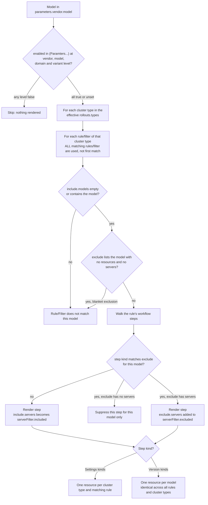

Cluster types, models and resource kinds are filtered by Helm at render time: they decide which CRs exist. Servers are different. The chart never enumerates real server names, so `include.servers`/`exclude.servers` are not evaluated by Helm; they are copied into the CR's selector as `matchExpressions` on the server-name label (`labelKeys.serverName`), and the operator applies the filter in the cluster. How a rule's servers become the resource's selector:

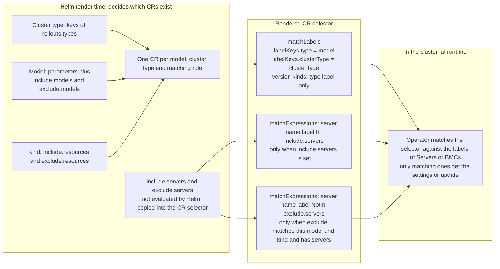

**Worked example** — `proliant-dl560-gen11` uses the global default `Workflow` (and `bios.settings.defaultSettings`) for `cc-kvm-compute` (one rule, matches every model), but `sci-k8s-controlplane`/`sci-k8s-management`/`sci-k8s-runtime`/`sci-k8s-storage`/`cc-ironcore` each have TWO rules routing just `proliant-dl560-gen11` to a `workflowSciSettings` variant (pointing `bios-settings.settingsKey` at `bios.settings.sciSettings` instead) and every other model to the default `Workflow` (this is the real, bundled `defaultRollouts.types` in `values.yaml` - shown here as a cluster override would set it, via the top-level `rollouts.types`):

```yaml
rollouts:
  types:
    sci-k8s-controlplane:
      - filter: { exclude: { models: [proliant-dl560-gen11] } }
        workflow: *workflow
      - filter: { include: { models: [proliant-dl560-gen11] } }
        workflow: *workflowSciSettings
    # ...sci-k8s-management/sci-k8s-runtime/sci-k8s-storage/cc-ironcore follow the same pattern...

parameters:
  hpe:
    proliant-dl560-gen11:
      bios:
        settings:
          defaultSettings: hpe-dl560-gen11-latest-kvm.yaml   # used for cc-kvm-compute
          sciSettings: hpe-dl560-gen11-sci.yaml              # used for sci-*/cc-ironcore
```

### setMetadataName (custom / dynamic resource names)

By default every chain step's resource gets a generated name (`<vendor>-<model>(-<clusterType>)(-<stepName>)`). Setting `setMetadataName` on a `Workflow` step definition (see [Workflow](#workflow--the-static-workflow-shape) above) overrides this:

- **Settings kinds** (`bmc-settings`/`bios-settings`, rendered once per cluster type): the final name is `"<setMetadataName>-<clusterType>"`.
- **Version kinds** (`bmc-version`/`bios-version`, rendered once per model): `setMetadataName` is used verbatim.

It may contain `{{ }}` Go template expressions, resolved via Helm's `tpl` against the chart's root context before use:

```yaml
setMetadataName: "abc-123"                                 # -> abc-123(-<clusterType>)
setMetadataName: "abc-{{ .Values.clusterConfig.region }}"  # -> abc-<region>(-<clusterType>)
```

Because `setMetadataName` lives on the shared step definition, a literal string applies identically to every model resolving that `Workflow` (or variant). A per-model custom name therefore needs its own named `Workflow` variant (with `setMetadataName` set on the relevant step) assigned via a `rollouts.types` rule scoped to just that one model — see [UC11](#uc11-give-a-resource-a-custom--dynamic-name) below for a worked example.

Resource names must be unique across the whole chart — a duplicate name (after any `-<clusterType>` suffix) fails the render with an error naming the conflicting entry/model/clusterType.

How the final name is built. `setMetadataName` and `readinessGates` are independent inputs: an explicit name is never touched by `readinessGates`, which only affects generated names.

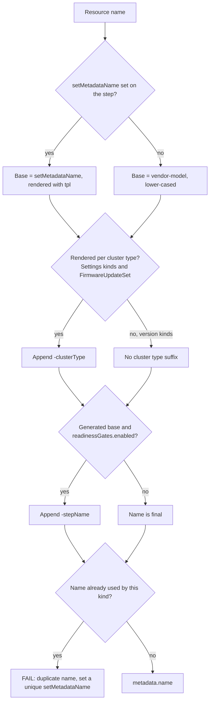

### Firmware Repository (`firmwareRepo`)

The `firmwareRepo` configuration controls how firmware image URLs are composed for `BIOSVersionSet` and `BMCVersionSet` resources.

**Default behavior:**
```yaml
firmwareRepo:
  scheme: https          # Protocol (https or http)
  host: repo            # Hostname prefix
  hostOverride: ""      # Optional: override composed hostname
```

**URL composition:**

The firmware image URL is built from:
```
<scheme>://<host>.<global.region>.<global.tld><imagePath>
```

**Example:**
- `firmwareRepo.scheme`: `https`
- `firmwareRepo.host`: `repo`
- `global.region`: `eu-de-1`
- `global.tld`: `cloud.sap`
- `imagePath`: `/hw-firmware/dell/poweredge-r7615/BIOS_123.EXE`

**Result:** `https://repo.eu-de-1.cloud.sap/hw-firmware/dell/poweredge-r7615/BIOS_123.EXE`

**Override for special cases:**

If a cluster needs a completely different firmware repository (not just a different region), use `hostOverride`:

```yaml
firmwareRepo:
  scheme: http
  hostOverride: custom-repo.example.com
```

This bypasses the automatic `host.region.tld` composition.

**Legacy compatibility:**

For backward compatibility, a `versions.<key>` entry can set `imageURI` (full URL) instead of `imagePath`:

```yaml
parameters:
  dell:
    poweredge-r7615:
      bios:
        versions:
          defaultVersion:
            version: "1.11.2"
            imageURI: "https://legacy-repo.example.com/firmware/bios.exe"  # Takes precedence over imagePath
```

When `imageURI` is set, it is used directly and `firmwareRepo` configuration is ignored for that specific variant.

### Region-Specific Settings Overrides (`settingsContent`)

For specific BIOS or BMC settings overrides (stored in other values files), use `settingsContent` to provide inline YAML instead of referencing a bundled file:

**In region-specific values file** :

```yaml
# Define settings content once via YAML anchors, reference multiple times to avoid duplication
_biosSettingsContent:
  myCustomSettings: &myCustomSettings |
    settingsFlow:
    - name: myFlow
      priority: 10
      settings:
        Setting1: Value1
        Setting2: Value2

parameters:
  dell:
    poweredge-r860-custom:
      bios:
        versions:
          defaultVersion:
            version: "2.9.4"
            imagePath: "/hw-firmware/dell/poweredge-r860/BIOS_457WM.EXE"
        settings:
          defaultSettings:
            settingsContent: *myCustomSettings   # Use inline content instead of settingsFileName

# Scope this model's resources to specific nodes via a rollouts.types rule (cluster override shown
# here - this could also live in defaultRollouts.types in values.yaml):
rollouts:
  types:
    cc-kvm-compute:
      - filter:
          include: { models: [poweredge-r860-custom], servers: [node003-bb086, node009-bb086] }
        workflow: *workflow
```


**Behavior:**
- If `settingsContent` is provided, it is used (takes precedence over `settingsFileName`)
- If `settingsContent` is absent, the chart falls back to `settingsFileName` (loads from bundled `bios_settings/` or `bmc_settings/`)
- Use YAML anchors (`&name`) and aliases (`*name`) to define settings once and reference them multiple times — this prevents duplication across region-specific overrides
- Helm deep-merges region-specific values on top of base values, so only override entries that differ

## Use Case Examples

### UC1: Deploy Everything (Default)

Deploy all resources, for every cluster type in the catalog, to all regions:

```yaml
# values.yaml (default)
crdVersionControl:
  features:
    biosSettings:
      enabled: true
# no top-level rollouts: override -> falls back to defaultRollouts.types (the full catalog)
```

### UC2: Scope to the Real Cluster Type(s) (recommended per-cluster override)

Set this in the cluster's own kube-secrets/foundation-deployment values override so only the cluster types that actually exist get a resource:

```yaml
rollouts:
  types:
    sci-k8s-runtime:
      - workflow: *workflow
```

Only the cluster type(s) listed here get Settings resources generated — see [rollouts.types](#rolloutstypes--workflowserver-selection-keyed-by-cluster-type) above for the full rule-list schema.

**Referencing `Workflow`/`workflowSciSettings`/etc. from a separate cluster override file:** , reference it as a `tpl`-evaluated string — by render time `.Values` is the fully-merged tree across every values file, so `.Values.workflow` resolves correctly without any duplication:

```yaml
rollouts:
  types:
    sci-k8s-runtime:
      - workflow: "{{ .Values.workflow | toYaml }}"
```

### UC3: Disable a Vendor Entirely

```yaml
parameters:
  hpe:
    enabled: false
```

### UC4: Disable a Specific Model

```yaml
parameters:
  dell:
    poweredge-r7615:
      enabled: false
```

### UC5: Disable Just One Domain for a Model

Keep BMC firmware/settings but skip BIOS entirely for this model:

```yaml
parameters:
  dell:
    poweredge-r7615:
      bios:
        enabled: false
```

### UC6: Disable a Not-Yet-Ready Settings/Version Variant

```yaml
parameters:
  hpe:
    proliant-dl380-gen11:
      bmc:
        settings:
          initialSettings:
            enabled: false
            settingsFileName: hpe-default.yaml
```

### UC7: Combination (Targeted Rollout)

Render exactly one `BIOSSettingsSet`, for Dell PowerEdge R7615 only, control-plane cluster type only:

```yaml
parameters:
  hpe:
    enabled: false
  lenovo:
    enabled: false
  # ... disable every other Dell model too
rollouts:
  types:
    sci-k8s-controlplane:
      - workflow: *workflow
```

### UC8: Disable a Resource Type Entirely

```yaml
crdVersionControl:
  features:
    biosSettings:
      enabled: false

    biosVersions:
      enabled: true

    bmcVersions:
      enabled: true
```

### UC9: Override Region-Specific BMC Settings

In a region-specific values file (e.g., `kube-secrets`), override BMC settings for specific nodes and enable BMC settings deployment:

```yaml
# kube-secrets/values/helm/metalapi/<region>/<cluster>/metal-settings.yaml

# Define BMC settings content once via YAML anchors
_bmcSettingsContent:
  customDellIdrac: &customDellIdrac |
    settingsFlow:
    - name: syslogConfiguration
      priority: 10
      settings:
        SyslogServer: "{{ .Values.clusterConfig.syslogServer }}"
        SyslogPort: 514
    - name: snmpConfiguration
      priority: 20
      settings:
        SnmpCommunity: "public"

crdVersionControl:
  features:
    bmcSettings:
      enabled: true

clusterConfig:
  configMapName: metal-bmc-settings
  syslogServer: "syslog.region-qa-de-1.cloud.sap"

parameters:
  dell:
    poweredge-r860:
      bmc:
        versions:
          defaultVersion:
            version: "7.20.60.50"
            imagePath: "/hw-firmware/dell/poweredge-r860/..."
        settings:
          defaultSettings:
            settingsContent: *customDellIdrac    # Use region-specific BMC settings override
```

This example:
- Defines BMC settings content with templated values (e.g., `{{ .Values.clusterConfig.syslogServer }}`)
- Uses `settingsContent` to override the default `settingsFileName` from the base chart
- Enables `bmcSettings` only in this region (keeps it disabled elsewhere)
- Reuses the same settings across multiple models via YAML anchors

To additionally scope this model's resources to specific nodes, add `filter.include.servers` to the rule (see [UC13](#uc13-different-settings-for-one-specific-server-within-a-model) for the full worked `include`/`exclude` combination):

```yaml
rollouts:
  types:
    cc-kvm-compute:
      - filter:
          include: { servers: [node001-bb001, node002-bb001] }
        workflow: *workflow
```

### UC10: Enable Readiness-Gate Chaining

Chain each model's steps so they run strictly in order, gated on the previous step's completion. Requires `crdVersionControl.apiVersions.*` to already point at metal-maintenance-operator's groups:

```yaml
crdVersionControl:
  apiVersions:
    biosSettingsSet: "system.metal.ironcore.dev/v1alpha1"
    bmcSettingsSet: "baseboard.metal.ironcore.dev/v1alpha1"
    biosVersionSet: "system.metal.ironcore.dev/v1alpha1"
    bmcVersionSet: "baseboard.metal.ironcore.dev/v1alpha1"
  features:
    readinessGates:
      enabled: true
```

See [crdVersionControl](#crdversioncontrol--readiness-gate-chaining) above for the full behavior.

### UC11: Give a Resource a Custom / Dynamic Name

```yaml
parameters:
  dell:
    poweredge-r770-nic-slot10:
      bios:
        versions:
          defaultVersion:
            version: "1.8.5"
            imagePath: "/hw-firmware/dell/poweredge-r770/BIOS_VTF4T.EXE"
        settings:
          defaultSettings: dell-r770-nic-slot10.yaml
```

`setMetadataName` lives on the `Workflow` step definition, not under `parameters:`, so a custom name for just this model's `bios-settings` step needs its own named `Workflow` variant, assigned via a `rollouts.types` rule scoped to just this model:

```yaml
rollouts:
  types:
    cc-kvm-compute:
      - filter: { exclude: { models: [poweredge-r770-nic-slot10] } }
        workflow: *workflow
      - filter: { include: { models: [poweredge-r770-nic-slot10] } }
        workflow: *workflowR770NicSlot10

workflowR770NicSlot10: &workflowR770NicSlot10
  # ...other steps unchanged (copy from Workflow)...
  biosSettings:
    order: 5
    kind: BIOSSettingsSet
    versionKey: bios.versions.defaultVersion
    settingsKey: bios.settings.defaultSettings
    setMetadataName: dell-poweredge-r770-nic-slot10
```

See [setMetadataName](#setmetadataname-custom--dynamic-resource-names) above for `tpl`-based dynamic naming.

### UC12: Different Settings Per Cluster-Type Group For One Model

Different BIOS tuning per cluster type for the same physical model (this is the real, bundled `defaultRollouts.types` in `values.yaml` for `proliant-dl560-gen11` - shown here as a cluster override would set it):

```yaml
rollouts:
  types:
    sci-k8s-controlplane:
      - filter: { exclude: { models: [proliant-dl560-gen11] } }
        workflow: *workflow
      - filter: { include: { models: [proliant-dl560-gen11] } }
        workflow: *workflowSciSettings
    sci-k8s-management:
      - filter: { exclude: { models: [proliant-dl560-gen11] } }
        workflow: *workflow
      - filter: { include: { models: [proliant-dl560-gen11] } }
        workflow: *workflowSciSettings

parameters:
  hpe:
    proliant-dl560-gen11:
      bios:
        settings:
          defaultSettings: hpe-dl560-gen11-latest-kvm.yaml   # used for cc-kvm-compute
          sciSettings: hpe-dl560-gen11-sci.yaml              # used for sci-k8s-controlplane/-management
```

### UC13: Different Settings For One Specific Server Within a Model

`include`/`exclude` alone can only scope by model/kind, not by individual server - `servers` is how a rule reaches down to exactly ONE node (not the whole model, not a whole cluster type) without gating whether the rule matches (servers are never known at template time, only forwarded as a label selector) - the real `a-qa-de-100` pattern for Dell PowerEdge R770 node `node004-bb098`, which needs a NIC-slot10-specific BIOS settings flow that every other R770 must NOT get. Unlike `setMetadataName`-only variants (UC11), this needs NO second `parameters` entry — it's still one real model, `poweredge-r770`, with two `settings` variants:

```yaml
parameters:
  dell:
    poweredge-r770:
      bios:
        settings:
          defaultSettings: dell-r770.yaml
          nicSlot10Settings: dell-r770-nic-slot10.yaml
```

Splitting only `bios-settings` by server, while every other step (`bmc-settings`/`bmc-version`/`bios-version`/`firmware`) stays uniform across every `poweredge-r770` server, takes just **two** rules — one broad rule covering everything for `poweredge-r770` (its `exclude.servers` carves `node004-bb098` out of just its `BIOSSettingsSet` step, leaving every other step, and every other server's `BIOSSettingsSet`, untouched), plus one narrow rule covering only `node004-bb098`'s `BIOSSettingsSet`. Both rules reference the exact same, completely unmodified `*workflow` for everything except the split step - no disabled/omitted-step Workflow variant is needed for the broad rule, which matters because a disabled or omitted step still participates in the `readinessGates` cascade if it's present in a Workflow at all (its absence shifts what "the nearest preceding step" means for the steps after it) - `exclude` sidesteps this by narrowing only the matched step's own `serverFilter`, never touching cascade/`completionConditionType` computation:

```yaml
rollouts:
  types:
    cc-ironcore:
      - filter:
          exclude:
            models: [poweredge-r770]
            resources: [BIOSSettingsSet]
            servers: [node004-bb098]
        workflow: *workflow
      - filter:
          include:
            models: [poweredge-r770]
            resources: [BIOSSettingsSet]
            servers: [node004-bb098]
        workflow: *workflowR770NicSlot10

workflowR770NicSlot10: &workflowR770NicSlot10
  biosSettings:
    order: 5
    kind: BIOSSettingsSet
    versionKey: bios.versions.defaultVersion
    settingsKey: bios.settings.nicSlot10Settings
    setMetadataName: dell-poweredge-r770-nic-slot10
    readinessGatesOverride:
      - type: metal.cloud.sap/step3-bios-version-done
        requiredStatus: "True"
```

Both rules' `include`/`exclude` only match `poweredge-r770` - every other model is unaffected. The first rule renders `bmc-settings`/`bmc-version`/`bios-version`/`firmware` uniformly for every R770 server, AND renders `BIOSSettingsSet` for every R770 server except `node004-bb098` (its `serverSelector.matchExpressions` end up `NotIn [node004-bb098]`) - all from one continuous, single cascade pass, so `bios-settings`' `readinessGates` auto-computes correctly against this same rule's own `bios-version` step with no override needed on the broad rule. The second rule renders ONLY `BIOSSettingsSet`, scoped to just `node004-bb098` (`In [node004-bb098]`) - since its `Workflow` is a standalone, sparse one-step chain (no preceding `bios-version` of its own), its `readinessGates` needs the explicit `readinessGatesOverride` shown above, matching what the broad rule's auto-cascade computes for the same step name/order.

In practice, this is the standard pattern for "one specific server within a model needs a different variant of just one step": a broad rule whose `exclude.servers` carves the split kind away from one server for the model, plus a narrow `include`-scoped rule (or more, for more servers) covering just that server with its own Workflow variant for that one step - no separate Workflow variant is needed for the broad rule's role, since `exclude` only narrows its existing `*workflow` reference in place.


## Available Cluster Types

`defaultRollouts.types` (in `values.yaml`) is the full catalog:

- `cc-kvm-compute`
- `sci-k8s-controlplane`
- `sci-k8s-management`
- `sci-k8s-runtime`
- `sci-k8s-storage`
- `cc-ironcore`

The top-level `rollouts.types:` (unset by default) is where a real cluster's actual type(s) should be set — see [Cluster-Type Scoping](#cluster-type-scoping-and-enabled-toggles) above. See `parameters:` in `values.yaml` for the full, current vendor/model inventory — static copies here tend to drift out of date as models are added/retired.

## Settings Files

### BIOS Settings (`bios_settings/`)

BIOS settings flow content is stored as flat YAML files under `bios_settings/`, referenced via `settings.<key>` (or a `settingsFileName` on the object form) in `values.yaml`:

```
dell-default.yaml             dell-r660-mgmt.yaml            dell-r6715.yaml
dell-r7615.yaml                dell-r770.yaml                 dell-r860-kvm.yaml
hpe-dl380-gen11.yaml           hpe-dl380-gen11-latest-kvm.yaml  hpe-dl380-gen12.yaml
hpe-dl560-gen11-kvm.yaml       hpe-dl560-gen11-latest-kvm.yaml  hpe-dl560-gen11-sci.yaml
lenovo-sr650.yaml              lenovo-sr650-v3.yaml           lenovo-sr655-v3.yaml
lenovo-sr850p.yaml             lenovo-sr850p-kvm.yaml         lenovo-sr850-v3.yaml
lenovo-sr850-v3-new.yaml       lenovo-sr950.yaml              lenovo-sr950-v3.yaml
```

### BMC Settings (`bmc_settings/`)

BMC settings are stored under `bmc_settings/` and also rendered via `tpl`. They may contain `{{ .Values.clusterConfig.* }}` references for the ConfigMap/Secret values. Per-BMC dynamic values (hostname, region, building-block) are resolved at reconcile time via `objectFieldRef` — not Helm templating.

```
dell-default.yaml   dell-initial-default.yaml   dell-r6715.yaml   dell-r770.yaml   hpe-default.yaml   lenovo-default.yaml
```

See each model's `parameters.<vendor>.<model>.<bmc|bios>.settings` in `values.yaml` for which file it actually uses.

## CI Integration

The chart includes CI test values in the `ci/` directory for automated testing:

| File | Description |
|------|--------------|
| `test-values.yaml` | Default configuration - deploys all resources |
| `filter-vendor-values.yaml` | Tests scoping to a single vendor (Dell only, via `parameters.<vendor>.enabled`) |
| `filter-targeted-values.yaml` | Tests a targeted rollout (specific vendor + model + cluster type) |

These files are used by [chart-testing](https://github.com/helm/chart-testing) in the CI pipeline to validate:
- Helm chart linting
- Template rendering with different `enabled`/`rollouts.types` configurations

## Testing

Run unit tests with helm-unittest:

```bash
helm unittest .
```

Unit test files are located in `tests/`:

| File | Description |
|------|--------------|
| `bios_settings_test.yaml` | Tests BIOSSettingsSet rendering, `enabled` cascading, and `rollouts.types` scoping |
| `bios_versions_test.yaml` | Tests BIOSVersionSet rendering and `enabled` cascading |
| `bmc_settings_test.yaml` | Tests BMCSettingsSet rendering, `enabled` cascading, and `rollouts.types` scoping |
| `bmc_versions_test.yaml` | Tests BMCVersionSet rendering and `enabled` cascading |

## Verifying Rendered Resources

Check resource counts before deploying:

```bash
# Count all BIOS resources
helm template . | grep -c 'kind: BIOSSettingsSet'

# Count Dell-only BIOS resources
helm template . --set parameters.hpe.enabled=false --set parameters.lenovo.enabled=false \
  | grep -c 'kind: BIOSSettingsSet'

# Preview resources scoped to a single real cluster type (requires a full rollouts.types
# override file - see ci/filter-targeted-values.yaml for a worked example)
helm template . -f ci/filter-targeted-values.yaml
```

